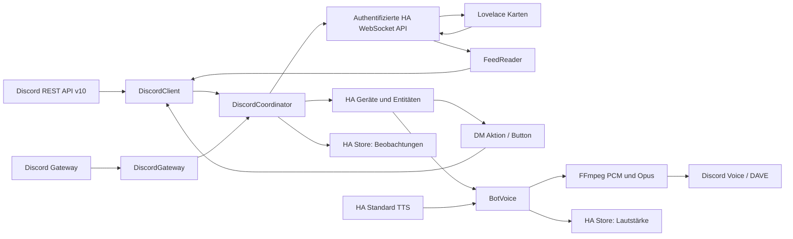

# Technische Architektur

Stand: 17.11.2026, Codebasis 1.0.1 (`f1e59cc`). Diese Übersicht ergänzt die
[Entwicklungsanleitung](development.md), [API](api.md), [Dashboard](dashboard.md)
und [Voice-Dokumentation](voice.md). Entscheidungen: [DECISIONS.md](DECISIONS.md).

## System und Datenfluss

Eigenständige HA Custom Integration in `custom_components/your_discord_connect`.
Kein zusätzlicher Prozess/Server erforderlich. Home Assistant ist der Laufzeit-Host;
Discord ist externe Datenquelle und Versand-/Voice-Ziel.

## Komponenten und Verantwortung

| Modul | Verantwortung |
| --- | --- |
| `__init__.py` | Dienste/Frontend registrieren, Entry einrichten, Plattformen laden, Optionen-Neuladen, Shutdown/Entfernen. |
| `config_flow.py` | Bot-Token, Serverauswahl, Rechteprüfung, Reauth und Intervalloption (1–1440 Minuten). |
| `api.py` | Gemeinsame HA-aiohttp-Session, REST-Paginierung, Avatare, DM-Versand, HTTP-Fehler und Rate-Limit-Sperre. |
| `gateway.py` | discord.py-Client, Verbindung/Resume, Presence-/Voice-Ereignisse, Mitgliedsabfragen, vollständige Kanalliste und Revisionsschutz. |
| `coordinator.py` | Vollständige Snapshots, Ereignispuffer während Sync, Registry-Bereinigung, gemeinsame Daten/DM-Entwürfe, Dashboard-Signal. |
| `activity.py` | Beobachtungslogik und persistente UTC-Zeitstempel; keine Abwesenheit durch Ausfälle. |
| `groups.py`, `entity.py`, `bot_entity.py` | Zentrale/Benutzer-Subentries, stabile Geräteidentität, dynamische Entitäten, zentraler Bot. |
| `sensor.py`, `binary_sensor.py` | Namen, Presence, Sprachkanal, Zeitstempel, Mute/AFK, Zähler, Wiedergabestatus. |
| `text.py`, `button.py` | TTS- und DM-Text, Ausführungsbuttons, manueller Vollabgleich. |
| `select.py`, `number.py` | Bot-Sprachkanal und Lautstärke. |
| `services.py`, `services.yaml` | Öffentliche DM-Aktion und `async_send_direct_message(hass, device_id, content)`. |
| `voice.py` | Kanalauswahl, Verbindungswechsel, TTS-Erzeugung, Audio-Queue, Wiedergabe, Lautstärke und Ressourcenbereinigung. |
| `dashboard.py` | Statische JS-Datei, authentifizierte WebSocket-Kommandos, Übersicht und begrenzter Feed-Cache. |
| `frontend/discord-cards.js` | Zwei Custom Elements und visuelle Editoren; kein Build-Schritt, keine Browser-Laufzeitpakete. |
| `strings.json`, `translations/` | Englische Basistexte sowie deutsche/englische HA-Texte. |

## Datenmodell, Identität und Lifecycle

Ein Server entspricht einem Config Entry mit `unique_id = guild_id`. Mehrere
Server sind möglich, mehrere Bots für denselben Server derzeit nicht.
`Member` und `MemberState` sind unveränderliche Snapshots. Namen und Avatare sind
Darstellungsdaten, `voice_channel_id` verhindert Verwechslungen gleichnamiger Kanäle.

- Mitgliedsgerät: `(DOMAIN, <guild_id>_<member_id>)`.
- Mitgliedsentität: `<guild_id>_<member_id>_<key>`.
- Zentralgerät: `<guild_id>_central`; Bot-Gerät: `<guild_id>_bot`.
- Gruppen: Config Subentries `central` und `users`; Mitglieder mit `via_device_id`
  an Zentrale gebunden. HA bestimmt die tatsächliche UI-Sortierung.
- Pro Mitglied: sieben Sensoren, vier Binärsensoren, ein DM-Text und ein DM-Button.
- Zentrale: manueller Sync und drei Zähler; Bot: Select, Text, Button, Status, Lautstärke.
- Nur der sicher identifizierte eigene Bot wird aus Benutzergeräten ausgeblendet.
  Daten/Zähler/Sprachübersicht enthalten ihn weiterhin.

Vollabgleich beim Start, manuell und alle 30 Minuten (gespeicherte Optionen haben
Vorrang). REST-Mitglieder werden seitenweise gelesen; Gateway-Abfrage in Gruppen
von maximal 100 IDs mit `presences=True`. Kanäle werden explizit nachgeladen.
Erst bei vollständigem Erfolg werden ausgetretene Geräte bereinigt. Neu hinzukommende
Mitglieder werden beim Vollabgleich entdeckt, nicht sofort durch Member-Join-Events.

Presence-/Voice-Ereignisse aktualisieren bekannte Mitglieder sofort. Während Sync
empfangene Ereignisse überschreiben ältere Query-Ergebnisse. Push-Listener setzen
den Polling-Timer nicht zurück. Kanal-Revisionen verhindern analog veraltete
REST-Kanalantworten. Bei Disconnect werden Zustände nicht verfügbar; Reconnect
fordert einen Vollabgleich an. Setup-Fehler, Unload und HA-Stopp schließen Ressourcen.

## Speicherung und Bedeutung der Zustände

Anwesend: `online`, `idle`, `dnd` **oder** Sprachverbindung. Abwesend: `offline`
**und** keine Sprachverbindung. Unbekannt bleibt unbekannt. Presence selbst wird
nicht umgedeutet. Erster bekannter Zustand und spätere Zustandswechsel setzen
`last_present`/`last_absent`; nicht jeder Poll. `last_gateway_event` bezieht sich
auf Presence-/Voice-Ereignisse des Mitglieds, nicht Heartbeats.

| Daten | Speicherung |
| --- | --- |
| Token, Server und Optionen | HA Config Entry, außerhalb des Repositories. |
| Beobachtungen | HA Store `your_discord_connect.<guild_id>.activity`, fünf Sekunden gebündelt und bei geordnetem Abschluss. |
| Lautstärke | HA Store `your_discord_connect.<guild_id>.voice`, Standard 50 %, Bereich 0–100 %. |
| DM-/TTS-Entwürfe, Kanalauswahl | Kein Restore durch die Integration; reguläre HA-Textzustände können dennoch Recorder-Historie haben. |
| Textkanal-Nachrichten | Nur begrenzter Feed-Arbeitsspeichercache, keine Feed-Entitäten/Recorder-Historie. |

## Schnittstellen und Zugriffsgrenzen

DM-Aktion: `your_discord_connect.send_direct_message`, Ziel ist eine **HA-Geräte-ID**,
kein Discord-Name/ID. Aktion/Python-API erlauben 1–2000 Zeichen, Mitgliedstextfeld
maximal 255 (HA-Zustandslimit). Expliziter Versand, keine automatische Wiederholung,
`allowed_mentions` deaktiviert Erwähnungsbenachrichtigungen. Button leert einen
unveränderten Entwurf erst nach Bestätigung; ein neuer Entwurf bleibt erhalten.

Frontend-Ressource: `/your_discord_connect/discord-cards.js?v=1.0.1`, manuell als
JavaScript-Modul registrieren. Custom Types:
`custom:discord-channel-overview`, `custom:discord-text-channel-feed`.

WebSocket-Kommandos (Präfix `your_discord_connect/`):

| Kommando | Daten/Verhalten |
| --- | --- |
| `servers` | Geladene, für den HA-Benutzer zugängliche Einträge. |
| `overview` | Abonnement mit `entry_id`; Server, Kategorie-/Sprachhierarchie, Mitglieder und Textkanalauswahl. Push plus 15-Sekunden-Lifecycle-Prüfung. |
| `feed` | Anfrage mit `entry_id`, `channel_id`; bis zu 50 Nachrichten. |

Zugriff benötigt Leserecht auf zentrale Sync-Entität. Übersicht prüft zusätzlich
Mitglieds-Anzeigenamenrechte. Feed prüft Bot-Sichtbarkeit/History-Rechte und Kanaltyp;
HA-Konten werden **nicht** auf individuelle Discord-Konten/Rechte abgebildet.
Feed-Benutzer können daher die für diesen Bot lesbaren Kanäle wählen. Details und
Grenzen in [dashboard.md](dashboard.md). Niemals Tokens an den Browser ausgeben.

Feed: REST-Polling standardmäßig 15 Sekunden (15–300 konfigurierbar), 15-Sekunden-
Cache, maximal acht Kanäle, gemeinsame serialisierte Abrufe. Kein Message-Gateway-
Abonnement. Message Content Intent muss für fremde Inhalte im Developer Portal
freigegeben sein; reine Mitglieder-/TTS-Funktionen benötigen es nicht.

## Voice und technische Basis

Bot in höchstens einem Sprachkanal pro Server; Dropdown beginnt mit `alle verlassen`.
TTS verwendet HA-Standard-Engine, keine zusätzliche TTS-Anmeldung. FFmpeg erzeugt
PCM, `PCMVolumeTransformer` regelt Lautstärke, discord.py kodiert mit libopus und
sendet mit Voice-/DAVE-Unterstützung. Nur lokale Audio-Pipes (`pipe,fd`), keine
beliebigen Medien-URLs. Subprozessstart im Executor, Callback threadsicher.

Maximal fünf aktive/wartende Aufträge; Text/Kanal werden beim Aufruf gebunden.
Kanalwechsel, Disconnect oder Unload brechen Aufträge ab. Grenzen: 255 Textzeichen,
60 Sekunden Erzeugung, 10 MiB Audio, 120 Sekunden Wiedergabe. Keine Aufnahme,
kein Video, kein Music-Assistant-Player.

Python >=3.14.2, HA-Testbasis 2026.10.4, uv 0.13.6; Discord 2.7.1, PyNaCl 1.6.2,
davey 0.2.0, CFFI-Constraint 2.0.0. Node 22 und Playwright 1.58.2 nur für
Frontend-Tests. Versionsautorität sind Manifest, Projektmetadaten und Lockfiles.
Tests und CI: [development.md](development.md); Windows/WSL: [WINDOWS.md](WINDOWS.md).
